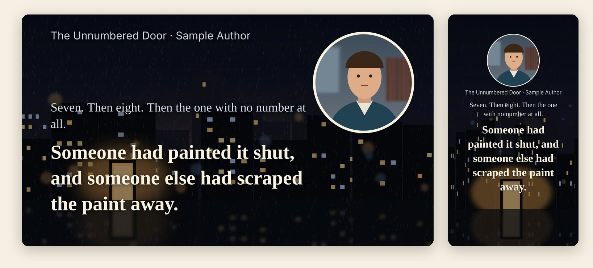
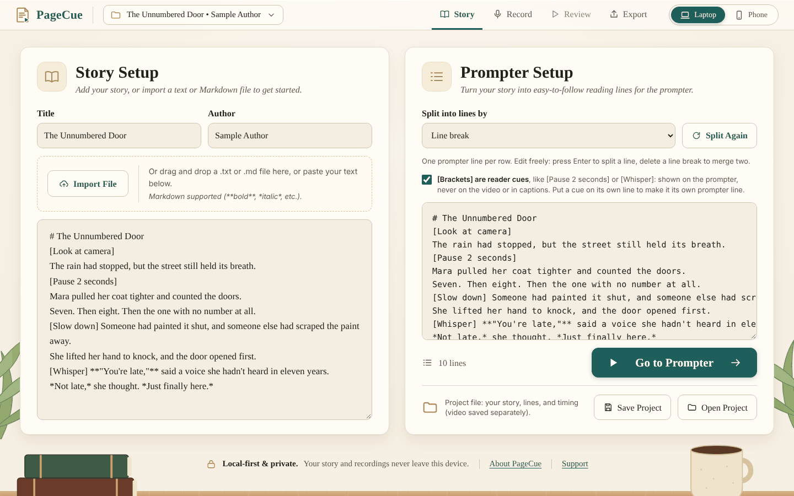
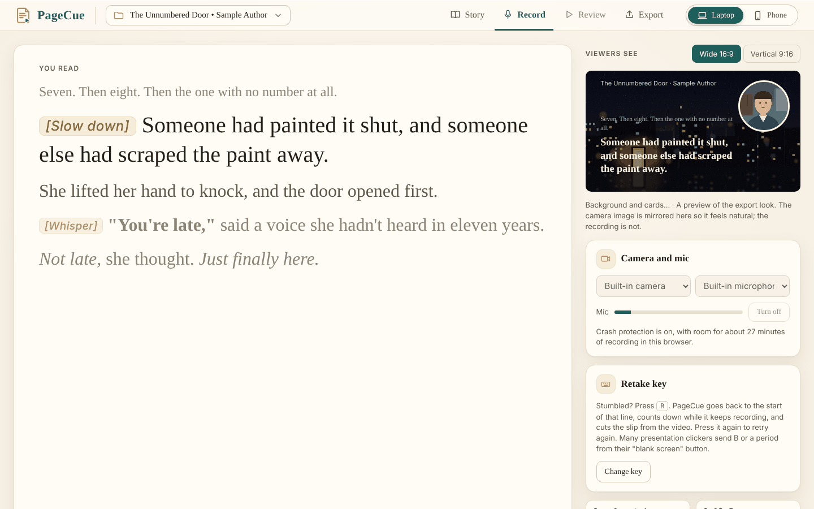
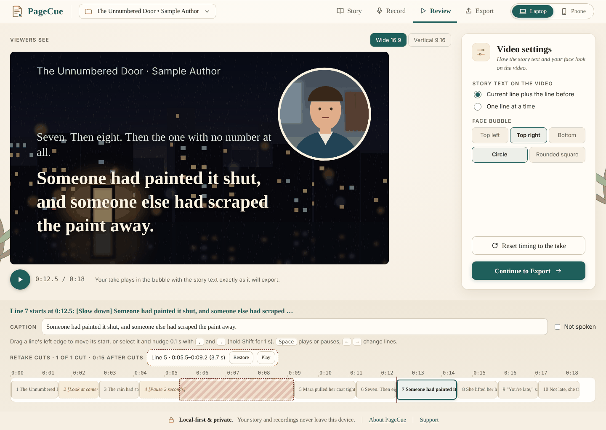
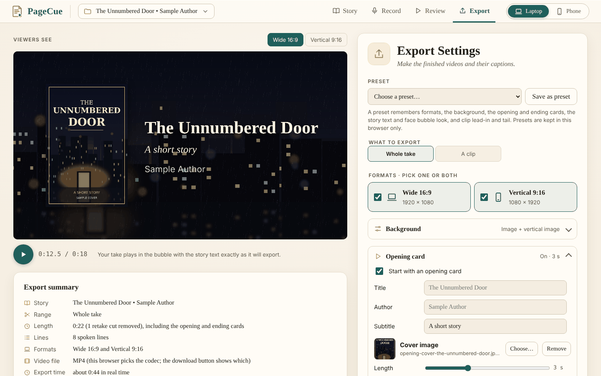
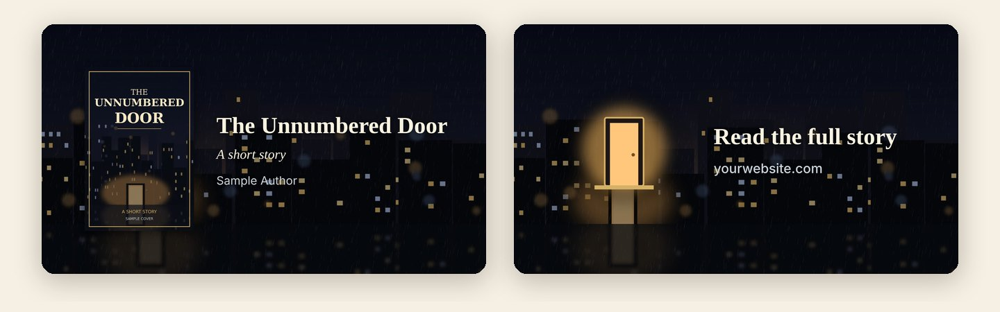

# PageCue

**A free, private reading prompter and recording studio for authors.**

Paste your story, read it from the prompter while your camera records, tap to move to each next line, and export finished videos, wide for YouTube and vertical for TikTok, Reels and Shorts, with your story on screen and your face in a corner bubble.

One HTML file. No install, no account, no uploads: your story and recordings never leave your device.

Exported frames, wide and vertical. The sample story, images and illustrated reader are placeholders made for this page.

## What it does

- **Read and record in one pass.** The prompter shows the line you're on, close to the camera, with the lines before and after. Tap Space, click, or use a presentation clicker to move to the next line; every tap times that line in the video.
- **Retake a stumble without stopping.** Press **R**, PageCue counts down, and you read the line again. The slip is cut from the video automatically.
- **Notes for yourself.** `[Pause 2 seconds]`, `[Whisper]`, `[Look at camera]` show on the prompter and never on the video or in the captions.
- **Fix timing afterward.** Drag lines on a timeline, correct a caption, or mark a line as not spoken.
- **Export wide, vertical, or both**, with an opening card, an ending card, a background image, and SRT/VTT captions built from your own script.
- **Clips.** Export any range of lines as its own short video.
- **Crash-safe recording.** Every second is saved as you record; if the browser or computer crashes, PageCue offers to recover the take.

## A look around

### Story
Paste your story, or import a `.txt` or `.md` file. PageCue splits it into prompter lines by sentence or by line break, and keeps **bold** and *italics*.

### Record
Read from the prompter while the camera records. Reader cues show as notes, and "Viewers see" previews the finished video live.

### Review
Your take plays back exactly as it will export. Fix any line's timing on the timeline; retake cuts are shown and can be restored.

### Export
Choose the whole take or a clip, wide and/or vertical, a background, and opening and ending cards. The preview is drawn by the same code as the export, so what you see is what you get. Each finished file is checked before you download it.

### Opening and ending cards

## Run it on your computer

Browsers only allow the camera and microphone on a secure address, and a file opened straight from a folder (`file://`) often doesn't count. PageCue includes a tiny launcher that serves it at **http://localhost:8765**, which does. It only listens on your own computer and needs no install.

| Computer | Double-click | Notes |
|---|---|---|
| Windows | `Start-PageCue.bat` | Uses the PowerShell that comes with Windows. If SmartScreen asks, choose *More info → Run anyway*. |
| Mac | `Start-PageCue.command` | Uses Python 3 (run `xcode-select --install` once if it's missing). The first time, right-click → *Open*. |
| Anything else | `python3 -m http.server 8765 --bind 127.0.0.1` in the PageCue folder | Then open http://localhost:8765 |

Keep the launcher window open while you use PageCue; close it to stop. If another copy of PageCue is already running, the launcher tells you instead of opening the wrong one.

**Browsers:** Chrome and Edge are fully tested. Safari and Firefox should work but haven't been tested yet.

## Your privacy

PageCue is local-first, and that's permanent:

- No automatic uploads or remote processing
- No cloud speech recognition
- No telemetry or automatic diagnostic reporting
- Your recordings, scripts and project data stay on your device

Takes, clips and presets are kept in your browser. A project file (`.pagecue.json`) carries your story, timing and look between computers; videos are separate files you download.

## Tips

**Retakes.** Press R again during the countdown to restart it without adding a second cut. Change the key on the Record screen; many presentation clickers send B or a period from their "blank screen" button.

**Reader cues.** Give a cue its own line to make it its own prompter line; during it, the video keeps showing the last spoken line. If your story uses brackets as story text (text messages, game screens), turn cues off on the Story screen.

**Clips.** On the Export screen, choose **A clip**, pick the first and last line, and add a little lead-in and tail. Save named clips to export them again later.

**Look.** Set the background and cards before you record if you like; the Export screen works without a take. Vertical videos keep the text and cards inside the area that platform buttons don't cover. Presets remember your usual formats, background and cards.

## Status

In development.

| Version | What | State |
|---|---|---|
| 0.1–0.3 | Story import, prompter, tap timing, recording, review and timeline | Done |
| 0.4 | Wide and vertical export, captions, recording recovery | Done |
| 0.5 | Retake mode | Done |
| 0.6 | Export screen, Clip Creator, presets, reader cues | Done |
| 0.7 | Background images, opening and ending cards | Done |
| 0.7.5 | Design pass: one consistent look across every screen | Done |
| 0.7.6 | Export sync fix and long-take testing | Testing |
| 0.8 | Book reading mode: DOCX and EPUB import, chapters | Planned |
| 0.9 | Voice-follow (experimental, on-device only) | Planned |
| 1.0 | Public release on GitHub Pages | Planned |

See [CHANGELOG.md](CHANGELOG.md) for the details of each version.

## Support

PageCue is free. If it helps you, you can [buy me a coffee](https://buymeacoffee.com/cer5061k).

PageCue is a sibling to [PhraseCue](https://github.com/greenguy27/phrasecue), the lyric prompter for singers.

## License

MIT. See [LICENSE](LICENSE). The name PageCue and its branding are not covered by the license.

---

By greenguy27 · [CRBooks.ink](https://crbooks.ink)
